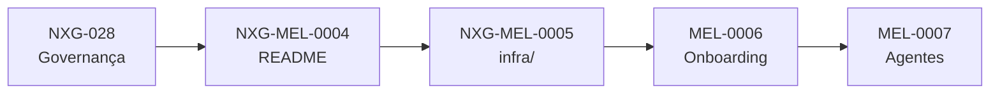

# NXG-EPIC-0001 — Organização do NX Gest

> [!info]- Navegação do épico
> **Projeto:** [[04 Projetos/Nxgest/README|Nxgest]]  
> **Plano de governança:** [[03 Trabalho/QA/Nxgest/Demandas/Planos/NXG-028 Governanca da reorganizacao do NX Gest|NXG-028]]  
> **Board QA:** [[01 Board/QA/BOARD QA — Nxgest|Board QA]]  
> **Board DEV:** [[01 Board/DEV/BOARD DEV — Nxgest|Board DEV]]

## Objetivo

Organizar o NX Gest segundo um padrão claro, reproduzível e fácil de clonar, preservando o funcionamento atual e separando adequadamente raiz, infraestrutura, ambientes, documentação e agentes.

## Escopo do épico

- Atualizar o mapa documental da raiz.
- Agrupar infraestrutura em `infra/` quando os caminhos e validações estiverem preparados.
- Organizar comandos e onboarding de ambientes.
- Manter `AGENTS.md` como contrato global e `.opencode/agents/` como agentes especializados.
- Consolidar o padrão de nomenclatura `nxgest`.
- Validar clone limpo, build, testes, documentação e compatibilidade de staging/produção.

## Fora de escopo

- Renomear volumes, redes, domínios ou diretórios reais da infraestrutura existente.
- Alterar segredos ou credenciais.
- Criar outro repositório oficial.
- Fazer deploy em produção sem autorização específica.

## Demandas vinculadas

| ID | Demanda | Relação | Estado |
|---|---|---|---|
| NXG-MEL-0004 | [[05 Arquivo/Nxgest/Melhorias/NXG-MEL-0004/QA/NXG-MEL-0004 README e mapa da raiz/00 README|README e mapa da raiz]] | primeiro lote documental | ✅ Concluído com ressalva |
| NXG-MEL-0005 | [[03 Trabalho/QA/Nxgest/Demandas/Melhorias/NXG-MEL-0005 Infraestrutura em infra/01 - Demanda|Infraestrutura em infra/]] | infraestrutura em `infra/` | 🟡 Em análise QA (CTs criados, aguardando gate) |
| MEL-0006 | a criar após aprovação do plano | scripts e onboarding | Backlog |
| MEL-0007 | a criar após aprovação do plano | agentes especializados | Opcional |

## Dependências

- [[03 Trabalho/QA/Nxgest/Demandas/Planos/NXG-028 Governanca da reorganizacao do NX Gest|NXG-028 — Governança da reorganização do NX Gest]] define decisões e lotes.
- O trabalho não commitado do repositório deve ser preservado antes de lotes estruturais.

## Fluxo do épico

## Status consolidado

| Gate | Situação |
|---|---|
| Escopo do épico | ✅ definido |
| Plano de governança | ✅ definido |
| NXG-MEL-0004 | ✅ concluído com ressalva documental |
| NXG-MEL-0005 | 🟡 pacote QA criado (7 CTs), aguardando gate de integridade e autorização para DEV |
| Lotes estruturais restantes (MEL-0006/0007) | ⏳ aguardando decisões |
| Execução no NX Gest | ✅ lote documental (NXG-MEL-0004) concluído · infraestrutura ainda não aplicada |

## Critério de conclusão

O épico será concluído quando as demandas vinculadas tiverem critérios aprovados, implementações revisadas, CTs executados, documentação sincronizada e nenhuma pendência bloqueante, sem exigir alteração não autorizada da infraestrutura real.
