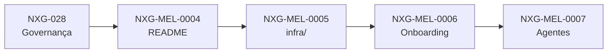

# NXG-EPIC-0001 — Organização do NX Gest

> [!info]- Navegação do épico
> **Projeto:** [[04 Projetos/Nxgest/README|Nxgest]]  
> **Plano de governança:** [[03 Trabalho/QA/Nxgest/Demandas/Planos/NXG-028 Governanca da reorganizacao do NX Gest|NXG-028]]  
> **Board QA:** [[01 Board/QA/BOARD QA — Nxgest|Board QA]]  
> **Board DEV:** [[01 Board/DEV/BOARD DEV — Nxgest|Board DEV]]

## Objetivo

Organizar o NX Gest segundo um padrão claro, reproduzível e fácil de clonar, preservando o funcionamento atual e separando adequadamente raiz, infraestrutura, ambientes, documentação e agentes.

## Escopo do épico

- Atualizar o mapa documental da raiz.
- Agrupar infraestrutura em `infra/` quando os caminhos e validações estiverem preparados.
- Organizar comandos e onboarding de ambientes.
- Manter `AGENTS.md` como contrato global e migrar a governança de agentes especializados para uma fonte canônica neutra em `agents/`, independente de plataforma (OpenCode, Claude Code, Codex).
- Consolidar o padrão de nomenclatura `nxgest`.
- Validar clone limpo, build, testes, documentação e compatibilidade de staging/produção.

## Fora de escopo

- Renomear volumes, redes, domínios ou diretórios reais da infraestrutura existente.
- Alterar segredos ou credenciais.
- Criar outro repositório oficial.
- Fazer deploy em produção sem autorização específica.

## Demandas vinculadas

| ID | Demanda | Relação | Estado |
|---|---|---|---|
| NXG-MEL-0004 | [[05 Arquivo/Nxgest/Melhorias/NXG-MEL-0004/QA/NXG-MEL-0004 README e mapa da raiz/00 README|README e mapa da raiz]] | primeiro lote documental | ✅ Concluído com ressalva |
| NXG-MEL-0005 | [[03 Trabalho/QA/Nxgest/Demandas/Melhorias/NXG-MEL-0005 Infraestrutura em infra/01 - Demanda|Infraestrutura em infra/]] | infraestrutura em `infra/` | ✅ Concluído com ressalva |
| NXG-MEL-0006 | [[05 Arquivo/Nxgest/Melhorias/NXG-MEL-0006/QA/NXG-MEL-0006 Onboarding de ambientes/00 README|Onboarding de ambientes]] | scripts e onboarding | ✅ Concluído com ressalva |
| NXG-MEL-0007 | [[03 Trabalho/QA/Nxgest/Demandas/Melhorias/NXG-MEL-0007 Agentes especializados/01 - Demanda|Agentes especializados]] | agentes especializados | 🔁 Em revisão de QA — arquitetura neutra |

## Dependências

- [[03 Trabalho/QA/Nxgest/Demandas/Planos/NXG-028 Governanca da reorganizacao do NX Gest|NXG-028 — Governança da reorganização do NX Gest]] define decisões e lotes.
- O trabalho não commitado do repositório deve ser preservado antes de lotes estruturais.
- Regra de sequência: nenhuma execução real do `NXG-MEL-0005` ocorre antes de `NXG-MEL-0006` estar criado e com gate QA aprovado (evita quebrar o onboarding de desenvolvimento entre os dois lotes).

## Fluxo do épico

## Status consolidado

| Gate | Situação |
|---|---|
| Escopo do épico | ✅ definido |
| Plano de governança | ✅ definido |
| NXG-MEL-0004 | ✅ concluído com ressalva documental |
| NXG-MEL-0005 | ✅ concluído com ressalva — QA independente aprovou (17/10) |
| NXG-MEL-0006 | ✅ concluído com ressalva (limitação de permissão Docker para reexecução, não defeito) |
| NXG-MEL-0007 | 🔁 pacote QA em revisão (fonte canônica neutra em `agents/`) — gate anterior invalidado, execução DEV anterior marcada obsoleta, aguardando novo `QA_READY_FOR_DEV` |
| Execução no NX Gest | ✅ documental (NXG-MEL-0004), infraestrutura (NXG-MEL-0005) e onboarding (NXG-MEL-0006) concluídos localmente · nenhum deploy real ainda |

## Critério de conclusão

O épico será concluído quando as demandas vinculadas tiverem critérios aprovados, implementações revisadas, CTs executados, documentação sincronizada e nenhuma pendência bloqueante, sem exigir alteração não autorizada da infraestrutura real.
